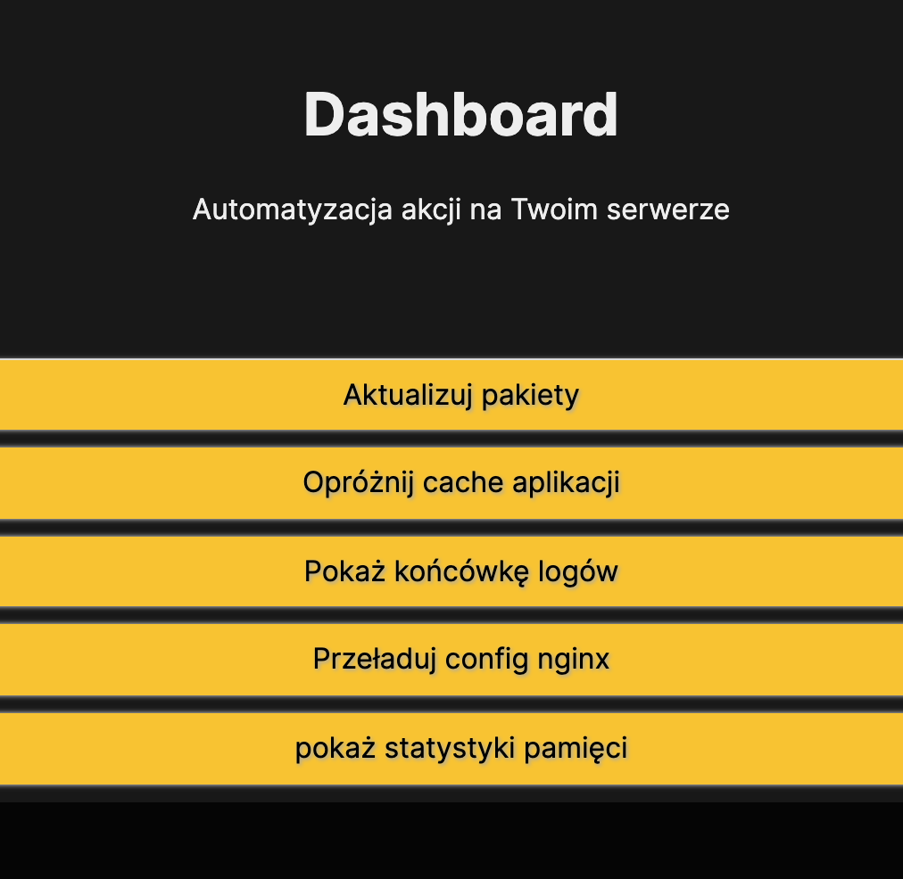

# Dashboard

Dashboard to prosta aplikacja, która umożliwia uruchamianie zdefiniowanych (przez Ciebie) poleceń na Mikrusie przy użyciu jednego kliknięcia.

Najprościej jest porównać tę usługę do pilota od TV. Masz tam wiele przycisków, a każdy z nich realizuje pewien cel. Możesz np. przypisać akcję aktualizacji systemu do pierwszego przycisku, restart Apache do drugiego, a np. operację ’git pull’ do trzeciego. Dzięki takiej konfiguracji jesteś w stanie zarządzać serwerem (a przynajmniej najczęstszymi operacjami) bez logowania się na VPSa.

Przykładowy dashboard stworzony przez użytkownika może wyglądać np. tak:



## Jak dodać akcję?

1. W panelu wybierz menu **Mikrus Services** → **[Dashboard](https://mikr.us/panel/?a=dash)**
2. Kliknij **Dodaj nową automatyzację**
3. Podaj nazwę akcji (to będzie napis na przycisku) oraz polecenia, które mają się wykonać
4. Zapisz zmiany

Każda z dodanych akcji będzie dostępna jako oddzielny przycisk na stronie [dash.mikr.us](https://dash.mikr.us). Strona działa także na telefonie, więc możesz np. zrestartować usługę, będąc poza domem.

## Przykładowe akcje

Aktualizacja systemu:

```bash
apt update && apt -y upgrade
```

Restart serwera WWW:

```bash
systemctl restart apache2
```

Aktualizacja strony z repozytorium Git:

```bash
cd /var/www/html && git pull
```

Sprawdzenie zajętości dysku i pamięci:

```bash
df -h / && free -m
```

## Ograniczenia

- czas wykonania skryptu to maksymalnie **60 sekund**
- skrypty nie wiedzą, czym jest "~" - zawsze **używaj pełnych ścieżek** (np. `/root/skrypt.sh` zamiast `~/skrypt.sh`)
- katalogiem roboczym skryptu jest `/`
- możesz zdefiniować maksymalnie **7 akcji** (z Mikrusem PRO - 50)

> 💡 Jeśli akcja wymaga więcej czasu, niech skrypt uruchomi zadanie w tle (np. przez `nohup` lub jako usługę systemd), a wynik prześle Ci mailem za pomocą [Pushera](../pusher).

[Powrót do strony głównej](/)
